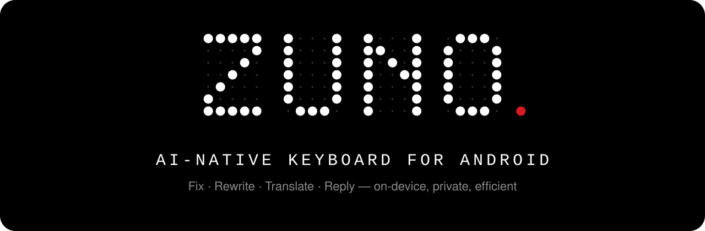
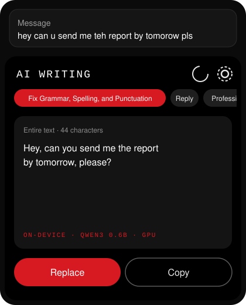
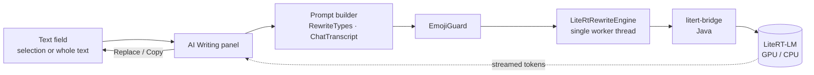

<div align="center">



<br/>

[](https://github.com/gamidirohan/Zuno-AI-Native-Keyboard/releases)


[](LICENSE.md)

**Zuno is an Android keyboard with a small language model built in.**
It fixes your writing, changes its tone, translates it and drafts replies, all on your phone,
without sending a word of what you type to a server.

[Features](#features) · [Screenshots](#screenshots) · [Install](#install) · [Build](#build-from-source) · [How it works](#how-it-works) · [Credits](#credits) · [License](#license)

</div>

---

## Why Zuno

AI writing tools on phones usually mean copying text into a chatbot, or a keyboard that uploads what you type. Zuno puts the model **inside the keyboard** and runs it **on the device**:

- **Private by design.** The model runs locally; AI Writing makes no network requests after the one-time model download.
- **Where you already type.** Select text in any app, tap the sparkle button, then tap Replace.
- **Built for a phone.** A 0.6B-parameter model on the GPU, prompts tuned for small models, and output streamed as it is generated.

## Features

### AI Writing

| | What it does |
|---|---|
| **Fix Grammar, Spelling, and Punctuation** | Runs as soon as the panel opens, on the selection or the whole text field. One tap replaces the text. |
| **Tones** | Professional · Casual · Polite · Funny · LinkedIn · Shorten |
| **Translate** | English · Spanish · French · Portuguese · Japanese |
| **Reply** | Reads a chat copied from WhatsApp, knows which messages are yours, and drafts your next message. Type a rough idea first and Reply turns it into a finished message. |

Open it from the **sparkle button** on the toolbar, or **long-press the emoji button**. Every result can be replaced in place or copied.

### On-device model

- **[Qwen3 0.6B](https://huggingface.co/litert-community/Qwen3-0.6B)** running through Google's **[LiteRT-LM](https://github.com/google-ai-edge/LiteRT-LM)** runtime.
- **GPU first** (OpenCL) with automatic CPU fallback: **2.2× faster** than the CPU on a Nothing Phone (1). See [Performance](#performance).
- **Stays loaded** in the background, so the panel opens without a loading delay. You can turn this off to free about 1.5 GB of RAM.
- Downloaded in-app (586 MB, resumable, checked against a pinned SHA-256) or imported from a file.

### A keyboard that learns how you type

- **Words you keep.** Undo an autocorrection and Zuno stops changing that word. Do it twice and the word joins your dictionary and appears in suggestions. This is useful for Hinglish, Tanglish, Telugu-English, names and slang.
- **Your typos.** Delete a word and retype it, or tap a suggestion instead, and Zuno learns the pair (`kr → it`, `whys → why's`). After the second time, it fixes that typo for you.
- Everything it learns is listed under **Settings → Text Prediction → Learned Words**, where you can edit it. Nothing is learned in password or incognito fields.

### Nothing-inspired design

- **Dot-matrix look:** the [NDot](java/res/font) typeface in the suggestion bar, dot-style toolbar icons and a red accent.
- **Themes:** Nothing Dark, Nothing Light, AMOLED Nothing and a dynamic Nothing theme, alongside the Material themes.
- **Spacebar trackpad:** hold the spacebar and the keys go blank. Slide to move the cursor, with a haptic tick per step; a fast slide jumps by whole words, and sliding up and down moves between lines.
- **Haptics you control:** separate vibration strength and length settings.

It is still a full keyboard: swipe typing, voice input, clipboard history, emoji and multilingual layouts come from [FUTO Keyboard](https://keyboard.futo.org/).

## Screenshots

<p align="center">
  
</p>

<p align="center"><sub>The AI Writing panel (illustration). Device screenshots will be added with the next release.</sub></p>

## Install

1. Download the APK from the [latest release](https://github.com/gamidirohan/Zuno-AI-Native-Keyboard/releases).
2. Install it, then open **Zuno** and follow the setup to enable it as your keyboard.
3. Open AI Writing once to download the model (Wi-Fi only by default).

| Requirement | |
|---|---|
| Android | 7.0 (API 24) or newer |
| CPU | 64-bit ARM (`arm64-v8a`) |
| Free RAM for AI Writing | about 2 GB |
| Storage | about 130 MB app + 586 MB model |

> **Status: alpha.** Builds are debug-signed and tested on a Nothing Phone (1). Please [open an issue](https://github.com/gamidirohan/Zuno-AI-Native-Keyboard/issues) with your phone model if something breaks.

## Build from source

Requirements: **JDK 21** and the **Android SDK** with NDK (Android Studio Ladybug or newer includes both).

```bash
git clone --recursive https://github.com/gamidirohan/Zuno-AI-Native-Keyboard.git
cd Zuno-AI-Native-Keyboard

# Debug APK for arm64 phones
./gradlew :assembleStableDebug \
  -Pandroid.injected.build.abi=arm64-v8a \
  -Pandroid.injected.testOnly=false

# Unit tests
./gradlew :testStableDebugUnitTest
```

The APK is written to `build/intermediates/apk/stable/debug/`.

> Keep `-Pandroid.injected.testOnly=false`. The ABI flag otherwise marks the APK test-only, and phones refuse to install it ("package appears to be invalid").

## How it works



| Component | Path | Role |
|---|---|---|
| AI Writing UI | `java/src/.../uix/actions/ai/AiWriteAction.kt` | The panel; reads and replaces text through the `InputConnection` |
| Prompts | `.../ai/RewriteTypes.kt` | One short instruction per step, tuned for a 0.6B model |
| Chat parsing | `.../ai/ChatTranscript.kt` | Reads WhatsApp's copy and export formats for Reply |
| Engine | `.../ai/LiteRtRewriteEngine.kt` | GPU with CPU fallback, cancellation, timeouts, output limits |
| Runtime bridge | `litert-bridge/` | Java wrapper around LiteRT-LM (the app is on Kotlin 1.9; LiteRT-LM needs 2.x) |
| Learning | `java/src/.../latin/learning/` | Learned words and personal typos: pure-Kotlin rules plus storage |

**Design notes**
- **Small model, small steps.** Fixing all three things in one instruction missed most errors, so Fix runs three short passes (spelling, then grammar, then punctuation).
- **Emoji are kept away from the model.** Emoji outside Unicode's Basic Multilingual Plane made the runtime hang. `EmojiGuard` removes them before inference and puts them back afterwards.
- **Reusable.** The AI parts only need an `InputConnection`. You can copy `litert-bridge/` and `uix/actions/ai/` into another Android keyboard, and `learning/LearnedWordsCore.kt` has no Android dependencies.

### Performance

Measured on a **Nothing Phone (1)** (Snapdragon 778G+, 8 GB), running Fix Grammar, Spelling, and Punctuation on a one-sentence message:

| Backend | Tokens/s | First token | Full fix |
|---|---:|---:|---:|
| CPU (4 threads) | ~3.1 | 3.3 s | ~21 s |
| **GPU (OpenCL)** | **~6.4** | **1.3 s** | **~9 s** |

Thread count (2–8) made no difference on the CPU. The full methodology and results are in [docs/needs-access/performance.md](docs/needs-access/performance.md).

## Roadmap

- [ ] Device screenshots and a demo video
- [ ] Faster Fix (fewer passes) and a smaller model option
- [ ] On-device translation for Hindi, Telugu, Tamil and Bengali
- [ ] Release-signed builds and automated CI builds
- [ ] More phones tested

## Documentation

- [AI Writing design notes and test results](docs/AI_WRITING_ASSISTANT.md)
- [Performance on a Nothing Phone (1)](docs/needs-access/performance.md)
- [Device testing checklist](docs/needs-access/device-testing.md)
- [Known runtime risks](docs/needs-access/runtime-risks.md)
- [iOS research](docs/IOS_PLAN.md)

## Privacy

- **AI Writing is fully on-device.** The only network request it makes is the one-time model download from Hugging Face.
- The older **Translate** toolbar action, inherited from upstream, uses an online service. AI Writing's own Translate does not.
- An experimental screenshot assistant from upstream is still in the code. It is **disabled by default** and can't be reached from the keyboard.

## Contributing

Contributions are welcome: bug reports, phone test results, prompt improvements and code.

1. Fork the repository and create a branch.
2. Run `./gradlew :testStableDebugUnitTest` before opening a pull request.
3. For AI Writing or performance changes, mention the phone you tested on.

## Credits

Zuno is built on the work of these projects:

- **[FUTO Keyboard](https://keyboard.futo.org/)** by FUTO, the keyboard Zuno is based on (swipe typing, voice input, the transformer next-word model).
- **[AOSP LatinIME](https://android.googlesource.com/platform/packages/inputmethods/LatinIME)**, the Android Open Source Project keyboard underneath FUTO Keyboard.
- **[nth-kbd](https://github.com/arunk140/nth-kbd)** by Arun Khanchandani, the Nothing-themed fork this project started from.
- **[Qwen3](https://huggingface.co/Qwen/Qwen3-0.6B)** by the Qwen team (Apache-2.0), in the [LiteRT-LM conversion](https://huggingface.co/litert-community/Qwen3-0.6B) by litert-community.
- **[LiteRT-LM](https://github.com/google-ai-edge/LiteRT-LM)** by Google (Apache-2.0).

"Nothing" is a trademark of Nothing Technology Limited. Zuno is an independent project and is not affiliated with or endorsed by Nothing.

## License

Zuno is distributed under the **[FUTO Source First License 1.0](LICENSE.md)**, inherited from FUTO Keyboard.

This is a *source-available* license, not an OSI-approved open-source license. You may use, study, modify and share the code free of charge for **non-commercial** purposes, and you must keep FUTO's notices and payment features. Third-party components keep their own licenses; see [NOTICE](NOTICE).
